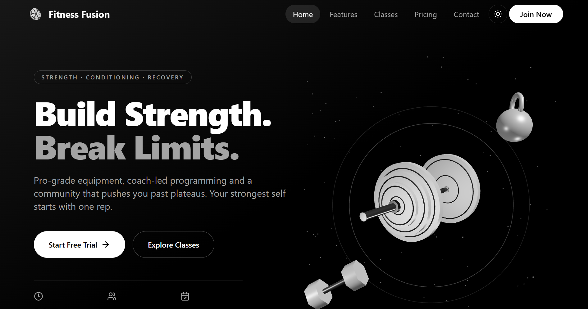

# Fitness Fusion Gym

A premium fitness studio landing page built with React, Vite, TypeScript, Tailwind CSS, and immersive 3D-inspired visuals. The project focuses on a modern gym brand experience with strong calls-to-action, class highlights, pricing plans, and an interactive contact section.

## Screenshot



## Features

- Hero section with bold branding and conversion-focused CTAs
- Animated stats and feature highlights
- Featured classes and membership plans
- Responsive design for desktop and mobile devices
- Reactive 3D visual elements using React Three Fiber
- Contact section with location and inquiry form

## Tech Stack

- React
- Vite
- TypeScript
- Tailwind CSS
- Framer Motion
- React Three Fiber
- Lucide Icons

## Getting Started

1. Install dependencies:

```bash
npm install
```

2. Start the development server:

```bash
npm run dev
```

3. Open the app in your browser:

```bash
http://localhost:5173
```

## Production Build

```bash
npm run build
```

To preview the production build:

```bash
npm run preview
```

## License

This project is for educational and portfolio purposes.
